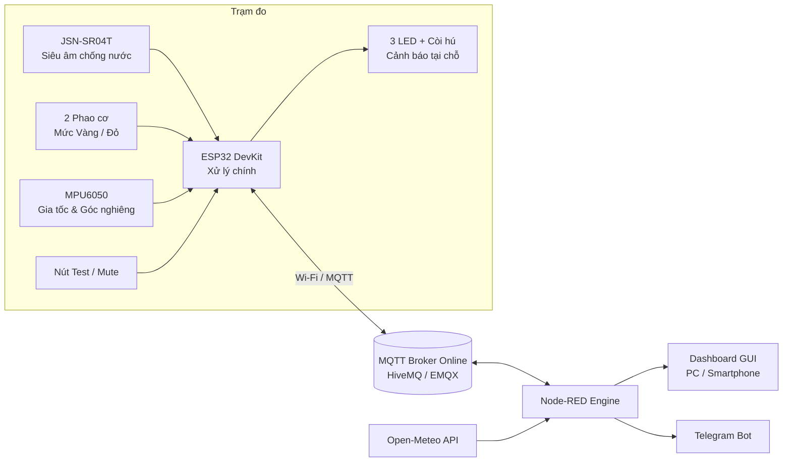
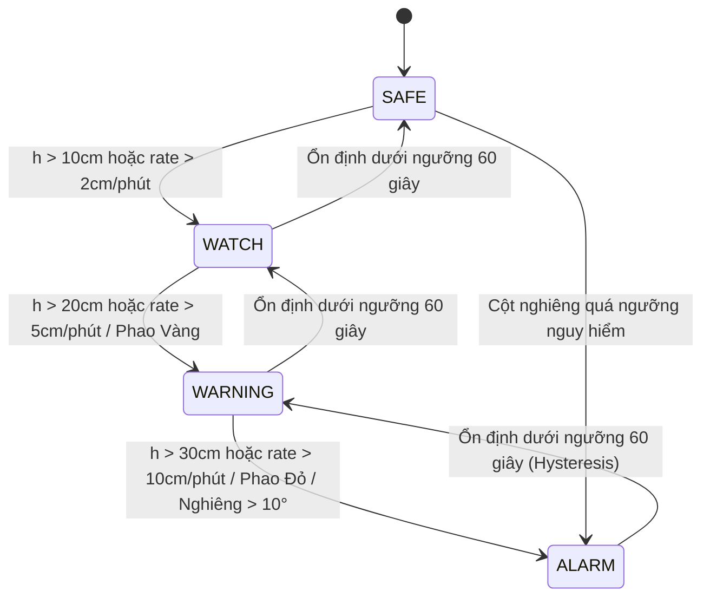

# Trạm Quan Trắc Thuỷ Văn Và Cảnh Báo Sớm Lũ Lụt

> **Mô tả:** Trạm cảnh báo lũ chi phí thấp sử dụng **ESP32**, giao thức **MQTT** và **Node-RED Dashboard** phục vụ quan trắc thủy văn và thu thập dữ liệu theo thời gian thực cho mô hình dự báo.

---

## Mục lục

1. [Đặt vấn đề](#1-đặt-vấn-đề)
2. [Mục tiêu và tính năng](#2-mục-tiêu-và-tính-năng)
3. [Kiến trúc hệ thống](#3-kiến-trúc-hệ-thống)
4. [Phần cứng & Sơ đồ nối dây](#4-phần-cứng--sơ-đồ-nối-dây)
5. [Thuật toán cảnh báo & MQTT](#5-thuật-toán-cảnh-báo--mqtt)
6. [Kịch bản kiểm thử & Hướng phát triển](#8-kịch-bản-kiểm-thử--hướng-phát-triển)

---

## 1. Đặt vấn đề

Tại các vùng miền núi Việt Nam, ngầm tràn và suối nhỏ có thể dâng nước chỉ trong vài chục phút khi có mưa lớn đầu nguồn. Đặc điểm nguy hiểm nhất của lũ quét là **tốc độ dâng ($\Delta h / \Delta t$)**, chứ không chỉ độ cao tuyệt đối của mực nước.

Các trạm quan trắc truyền thống thường có chi phí rất cao và chỉ phát cảnh báo tại các mốc lớn. Những điểm nguy hiểm nhỏ gần dân cư chưa có trạm cảnh báo tại chỗ.

**Đặt bài toán:** Thiết kế trạm IoT chi phí thấp, hoạt động tự chủ, phát còi hú tức thời tại chỗ và đồng bộ dữ liệu thời gian thực qua MQTT về trung tâm để phục vụ dự báo.

---

## 2. Mục tiêu và tính năng

| # | Tính năng | Mô tả chi tiết |
|---|---|---|
| 1 | **Đo mực nước** | Cảm biến siêu âm chống nước **JSN-SR04T** đo khoảng cách liên tục tới mặt nước |
| 2 | **Tính tốc độ dâng** | Tính $\Delta h / \Delta t$ bằng hồi quy tuyến tính trên cửa sổ trượt 60 giây (cm/phút) |
| 3 | **Cảm biến dự phòng** | 2 công tắc phao (mức Vàng/Đỏ) ngắt cứng vật lý, hoạt động độc lập khi siêu âm lỗi |
| 4 | **Giám sát kết cấu** | **MPU6050** đo góc nghiêng cột mốc, phát hiện sự cố sạt lở hoặc xô lệch do lũ |
| 5 | **4 Cấp cảnh báo** | `SAFE` $\rightarrow$ `WATCH` $\rightarrow$ `WARNING` $\rightarrow$ `ALARM` |
| 6 | **Cảnh báo tại chỗ** | 3 LED + Còi hú (Relay 12V), phản hồi tức thì không phụ thuộc vào internet |
| 7 | **Giao tiếp MQTT** | Đóng gói JSON gửi Telemetry, Event (Retain), Status (Last Will) |
| 8 | **Giao diện Dashboard** | Node-RED Dashboard hiển thị đồ thị, Gauge 3 màu, bấm nút Test/Mute còi từ xa |
| 9 | **Cảnh báo liên trạm** | Trạm thượng nguồn kích hoạt cảnh báo sớm (`prealert`) cho trạm hạ lưu |

---

## 3. Kiến trúc hệ thống



---

## 4. Phần cứng & Sơ đồ nối dây

### 4.1 Danh sách linh kiện (BOM)

| Linh kiện | SL | Vai trò | Ghi chú |
|---|---|---|---|
| ESP32 DevKit V1 | 1 | Vi điều khiển trung tâm, Wi-Fi/MQTT | 30 chân |
| JSN-SR04T | 1 | Đo khoảng cách mực nước (IP67) | Vùng mù 20-25cm |
| Công tắc phao CTP2508 | 2 | Cảm biến ngắt cứng dự phòng | Mức Vàng & Đỏ |
| MPU6050 | 1 | Giám sát góc nghiêng cột mốc | Giao tiếp I2C |
| LED 5mm (Xanh/Vàng/Đỏ) | 3 | Hiển thị cấp độ tại chỗ | Trở hạn dòng 220Ω |
| Module Relay 1 kênh + Còi 12V | 1 | Báo động âm thanh công suất lớn | Cách ly quang Opto |
| Tấm pin Solar + TP4056 + 18650 | 1 bộ | Khối nguồn độc lập Off-grid | Nguồn 5V/12V |

### 4.2 Bảng kết nối GPIO ESP32

| Thiết bị | Chân thiết bị | Chân ESP32 | Ghi chú kỹ thuật |
|---|---|---|---|
| JSN-SR04T | VCC / GND | VIN (5V) / GND | |
| | TRIG / ECHO | GPIO 5 / GPIO 18 | **ECHO qua cầu chia áp** (1kΩ + 2kΩ) về 3.3V |
| Phao Vàng / Đỏ | Tiếp điểm | GPIO 32 / GPIO 33 | Chế độ `INPUT_PULLUP`, nối GND |
| MPU6050 | SDA / SCL | GPIO 21 / GPIO 22 | Chuẩn I2C |
| LED Xanh / Vàng / Đỏ | Anode (+)| GPIO 27 / 14 / 15 | Nối qua trở 220Ω |
| Relay Còi hú | IN | GPIO 25 | Bật còi báo động |
| Nút Test/Mute | Tiếp điểm | GPIO 13 | Chế độ `INPUT_PULLUP` |

---

## 5. Thuật toán cảnh báo & MQTT

### 5.1 Máy trạng thái (State Machine)



### 5.2 Cấu trúc MQTT Telemetry Payload

- **Topic:** `hust-iot/floodwatch/node01/telemetry`
- **JSON Payload:**
```json
{
  "h": 24.5,
  "rate": 6.8,
  "tilt": 1.2,
  "state": "WARNING",
  "eta": 8.1,
  "us": "OK",
  "fm": 1,
  "fh": 0,
  "rssi": -61,
  "up": 3600
}
```

---


## 6. Kịch bản kiểm thử & Hướng phát triển

### 6.1 Kịch bản kiểm thử (Test Cases)
1. **Dâng nước chậm/nhanh:** Kiểm tra khả năng kích hoạt `WARNING`/`ALARM` theo mực nước và tốc độ dâng.
2. **Sự cố cảm biến siêu âm:** Ngắt chân siêu âm $\rightarrow$ Hệ thống chuyển sang chế độ `FAULT` và hoạt động hoàn toàn bằng phao cơ.
3. **Mất kết nối mạng:** Kiểm tra còi hú tại chỗ vẫn hoạt động độc lập khi ngắt Wi-Fi.

### 6.2 Hướng phát triển thực địa
* Chuyển sang mô-đun **4G/LTE (A7670C)** hoặc **LoRa** cho vùng không có sóng Wi-Fi.
* Đóng gói thiết bị theo chuẩn **IP66** ngoài trời với đầu siết cáp Cable Gland chống ẩm.
* Thu thập log dữ liệu thời gian dài làm tập huấn luyện cho mô hình **Machine Learning (LSTM)** dự báo lũ.

---
